<p align="center">
  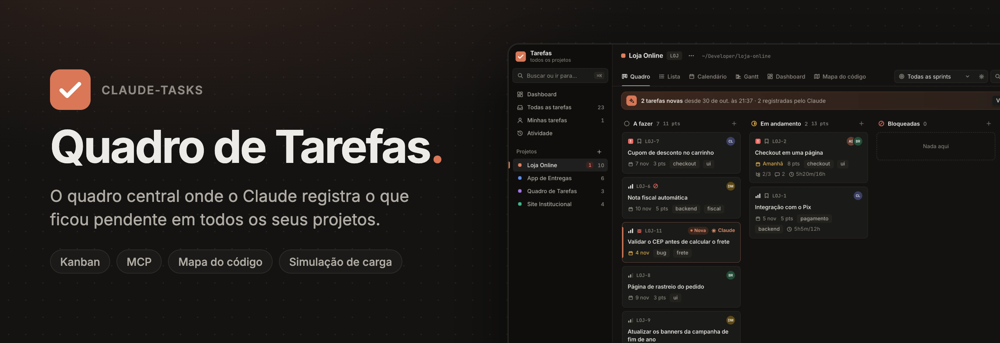
</p>

<h4 align="center">
  <a href="#instalação">Instalar</a> |
  <a href="docs/SISTEMA.md">Documentação</a> |
  <a href="docs/MCP.md">Servidor MCP</a> |
  <a href="docs/MAPA.md">Mapa do código</a> |
  <a href="#contribuindo">Contribuir</a>
</h4>

<div align="center">
  <h3>
    Você trabalha com o Claude em vários projetos. Ele anota o que ficou para depois.<br />
    Você acompanha tudo num quadro só.
  </h3>
</div>

<p align="center">
  <a href="https://github.com/editzffaleta/claude-tasks/actions/workflows/ci.yml"></a>
  <a href="LICENSE"></a>
  
  
  
  
  <a href="#contribuindo"></a>
</p>

<div align="center">
  <picture>
    <source media="(prefers-color-scheme: dark)" srcset="docs/imagens/todas-escuro.webp" />
    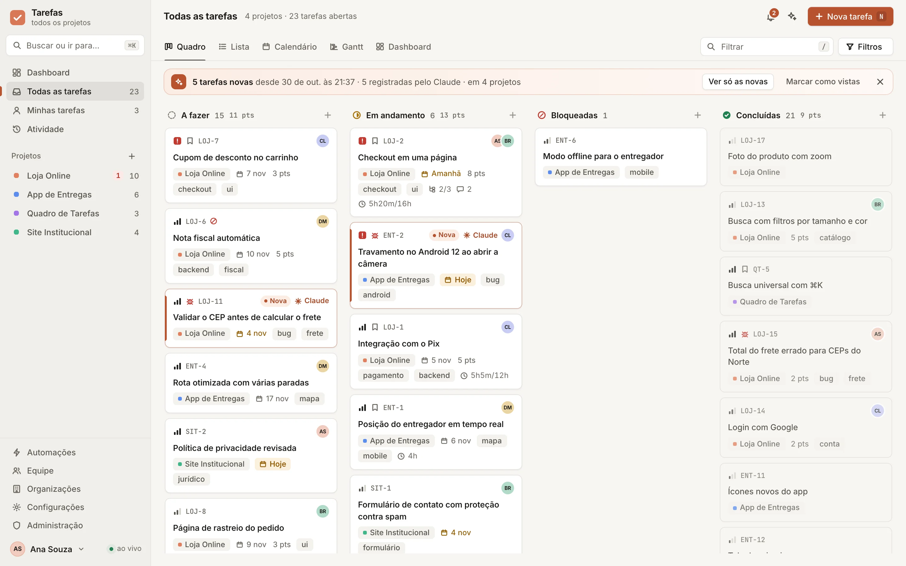
  </picture>
  <p align="center">
    <sub>Todas as tarefas de quatro projetos num quadro só. A faixa no topo conta o que chegou desde a sua última
    visita, e os cartões marcados com ✳ Claude foram registrados por ele enquanto trabalhava. Todas as imagens deste
    README usam projetos e pessoas de demonstração.</sub>
  </p>
</div>

O **Quadro de Tarefas** é um gerenciador de projetos que roda no seu computador e é alimentado pelo
Claude. Em qualquer projeto em que você abrir o Claude Code, quando ele deixa algo para depois,
encontra um bug que não corrigiu ou sugere um próximo passo, ele registra a tarefa aqui pelo servidor
MCP `tarefas`. Você e a sua equipe acompanham tudo no painel, em http://localhost:4317, com quadro
kanban, lista, calendário, Gantt, dashboard, sprints, automações e notificações.

Ele também traz o **Mapa do código**, um plugin que desenha um mapa interativo do código de cada
projeto, e a **Simulação**, que leva esse mapa ao simulador [Breakscale](https://breakscale.tech) para
mostrar onde o sistema quebra quando o tráfego sobe. Tudo roda só com o Node 22.13+ (o banco é o SQLite
embutido no próprio Node), sem dependências obrigatórias e todo em português, com o painel também em
inglês, espanhol, francês e alemão.

## Sumário

- [Por que existe](#por-que-existe)
- [Três jeitos de usar](#três-jeitos-de-usar)
- [Funcionalidades](#funcionalidades)
- [Mapa do código](#mapa-do-código)
- [Simulação: onde o sistema quebra](#simulação-onde-o-sistema-quebra)
- [O servidor MCP](#o-servidor-mcp)
- [Como funciona](#como-funciona)
- [Instalação](#instalação)
- [Usar em equipe](#usar-em-equipe)
- [Atalhos do teclado](#atalhos-do-teclado)
- [Dados, backup e privacidade](#dados-backup-e-privacidade)
- [Desenvolvimento](#desenvolvimento)
- [Documentação](#documentação)
- [Contribuindo](#contribuindo)
- [Licença e créditos](#licença-e-créditos)

## Por que existe

Quem trabalha com o Claude Code em vários repositórios conhece o problema: no fim de cada sessão
sobram pendências. Um teste que ficou para depois, um bug visto de passagem, uma melhoria sugerida.
Elas ficam espalhadas pelo histórico das conversas e somem quando a sessão acaba.

O Quadro de Tarefas dá a essas pendências um lugar só. O Claude registra cada uma no projeto certo
(o repositório git em que ele está), sem duplicar, com contexto suficiente para alguém retomar do zero.
Quando você volta ao projeto, ele já sabe o que está aberto. E você enxerga o conjunto, de todos os
projetos, como num gerenciador de projetos de verdade.

## Três jeitos de usar

### Pelo Claude, em qualquer projeto

Com o MCP instalado no escopo do usuário, toda sessão do Claude Code tem as ferramentas do quadro.
Ele registra pendências sozinho e responde a pedidos como estes:

- "O que está pendente neste projeto?"
- "Anota para depois: revisar os limites do upload de imagens."
- "Quebra essa tarefa em subtarefas e planeja a próxima sprint com 20 pontos."
- "Quanto tempo gastei na Loja Online essa semana?"
- "Move as tarefas de UI para a próxima sprint e avisa a Beatriz."
- "Faça o mapa do código deste projeto." e, depois, "Simule este projeto no Breakscale."

Os prompts do servidor também viram comandos no Claude Code, como `/mcp__tarefas__pendencias`,
`/mcp__tarefas__planejar_sprint` e `/mcp__tarefas__triagem`.

Para mandar o Claude resolver uma tarefa que já está no quadro, abra a tarefa no painel e clique em
**Mandar para o Claude**: o pedido vai para a área de transferência, pronto para colar numa sessão
aberta na pasta do projeto. Numa sessão, `/mcp__tarefas__resolver 28` faz o mesmo pelo número.

O **Codex** usa o mesmo quadro: registre o servidor nele (veja [Instalação](#instalação)) e o que ele
gravar aparece com o selo "Codex". No menu `⋯` da tarefa, **Mandar para o Codex** copia o mesmo pedido.

### No navegador ou no app do Mac

O painel em http://localhost:4317 (ou no [app para Mac](#app-para-mac), com ícone próprio no Dock) mostra tudo ao vivo: o que o Claude grava aparece em menos de um
segundo, sem recarregar a página. Você cria, arrasta e edita tarefas, organiza sprints, acompanha o
dashboard e convida a equipe.

### No chat do painel

O botão do Claude no painel abre um chat que usa as mesmas ferramentas, com as permissões de quem está
logado. Ele funciona com a CLI do Claude Code (a sua assinatura), com a API da Anthropic ou com qualquer
API compatível com a da OpenAI (OpenRouter, Ollama e outras).

## Funcionalidades

### O que é novo e o que o Claude fez, à vista

- **Novidades desde a sua última visita:** uma faixa no topo resume "5 tarefas novas desde ontem às 18:40 · 3
  registradas pelo Claude", com **Revisar as novas**, **Ver só as novas** e **Marcar como vistas**. Os cartões novos
  ganham uma brasa na borda e o selo **Nova** até você abri-los.
- **Triagem guiada:** **Revisar as novas** mostra uma tarefa por vez, com contador. Dá para decidir tudo pelo teclado:
  `1` a `5` para a prioridade, `I` para atribuir a você, `S` para a sprint ativa, `D` para o prazo, `Enter` para aceitar,
  `→` para pular e `Backspace` para arquivar. Termina em "Triagem zerada".

  <picture>
    <source media="(prefers-color-scheme: dark)" srcset="docs/imagens/triagem-escuro.webp" />
    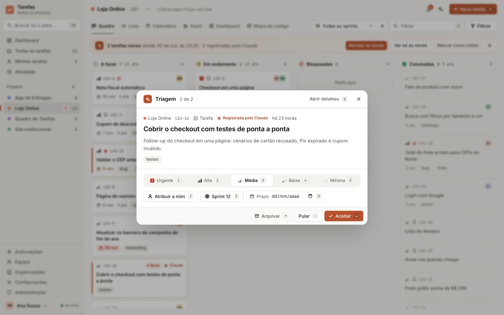
  </picture>

- **O Claude como colega de equipe:** o que ele registrou aparece com "✳ Claude" no cartão e "Registrada pelo
  Claude" no detalhe. O que o Codex registrou aparece com o selo "Codex".
- **Brasa viva:** quando uma tarefa muda por fora (o Claude pelo MCP, outra pessoa, uma automação), o cartão acende
  e apaga em poucos segundos. Dá para ver o quadro reagir enquanto o Claude trabalha.
- **Desfazer:** toda mudança de coluna mostra um aviso com **Desfazer**.

### Visualizações

<table>
  <tr>
    <td width="50%">
      <picture>
        <source media="(prefers-color-scheme: dark)" srcset="docs/imagens/lista-escuro.webp" />
        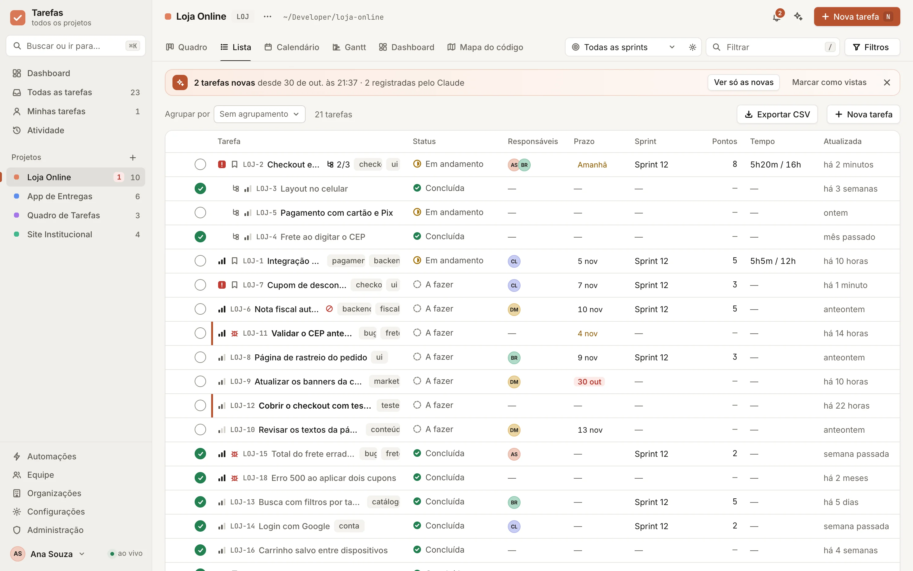
      </picture>
      <p align="center"><b>Lista</b>: agrupe, ordene e edite várias tarefas de uma vez</p>
    </td>
    <td width="50%">
      <picture>
        <source media="(prefers-color-scheme: dark)" srcset="docs/imagens/calendario-escuro.webp" />
        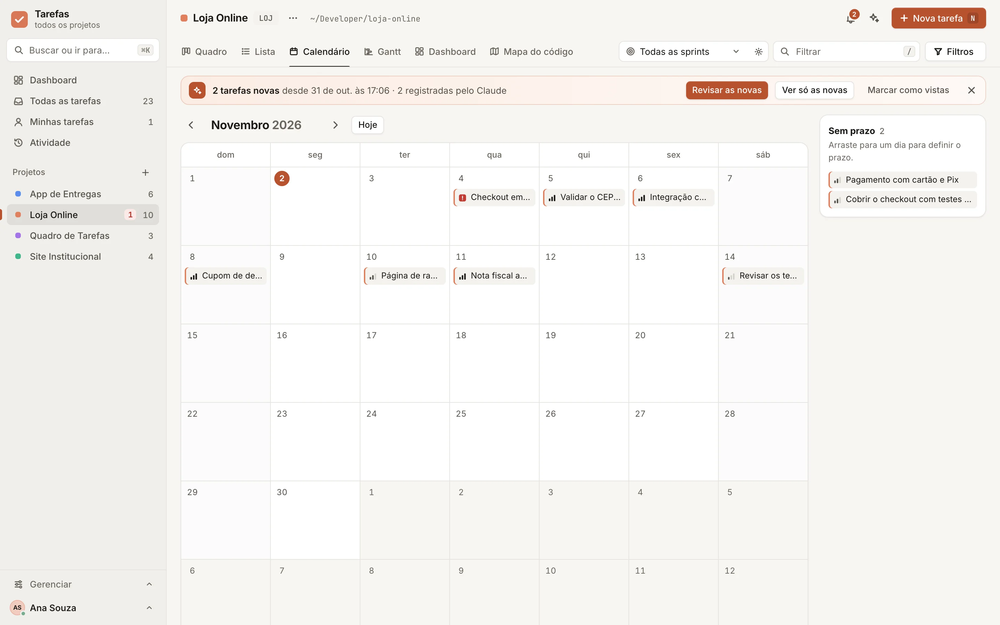
      </picture>
      <p align="center"><b>Calendário</b>: prazos do mês, com arrastar para reagendar</p>
    </td>
  </tr>
  <tr>
    <td width="50%">
      <picture>
        <source media="(prefers-color-scheme: dark)" srcset="docs/imagens/gantt-escuro.webp" />
        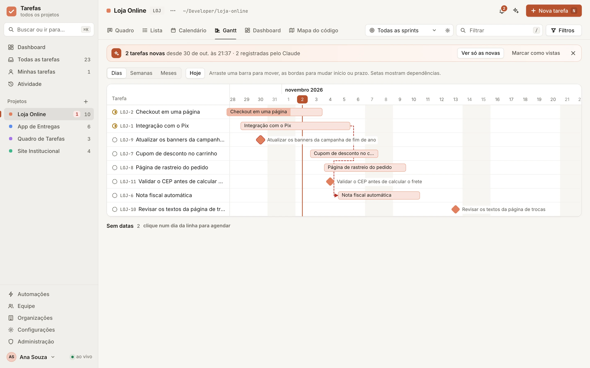
      </picture>
      <p align="center"><b>Gantt</b>: barras arrastáveis e dependências FS, SS, FF e SF</p>
    </td>
    <td width="50%">
      <picture>
        <source media="(prefers-color-scheme: dark)" srcset="docs/imagens/dashboard-escuro.webp" />
        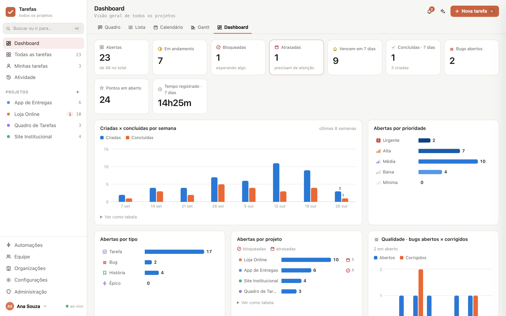
      </picture>
      <p align="center"><b>Dashboard</b>: indicadores, carga, burndown e velocidade</p>
    </td>
  </tr>
</table>

Além do **Quadro** kanban da imagem do topo, há a página **Atividade**, a lista **Minhas tarefas** e a
**busca universal** (`⌘K`), que acha tarefas, projetos e comandos.

### Tarefas

<picture>
  <source media="(prefers-color-scheme: dark)" srcset="docs/imagens/tarefa-escuro.webp" />
  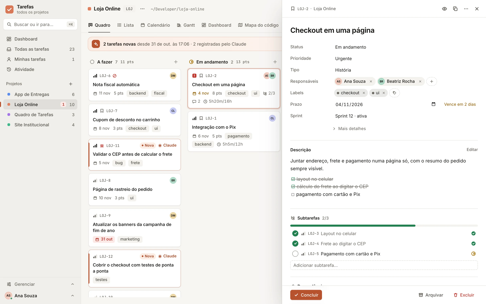
</picture>

- **Campos:** status, cinco prioridades, tipos (tarefa, bug, história, épico), labels coloridas,
  responsáveis, relator, observadores, início e prazo, story points, estimativa original e restante,
  campos personalizados por projeto.
- **Estrutura:** subtarefas com barra de progresso, dependências entre tarefas e projetos, anexos,
  descrição em Markdown com checklists.
- **Conversa:** comentários em fio com @menções e notificações para quem acompanha.
- **Tempo:** timer de um clique e lançamentos manuais, com relatório por tarefa, projeto, dia ou pessoa.
- **Recorrência:** diária, semanal (em dias escolhidos), mensal (num dia ou no último dia),
  trimestral e anual, com limite de repetições.
- **Sem duplicatas:** uma tarefa aberta com o mesmo título no mesmo projeto não é criada de novo,
  venha ela do Claude, do painel ou de um e-mail.

### Projetos, fluxo e sprints

- **Organizações → workspaces (aninháveis) → projetos.** Cada projeto tem prefixo próprio (`LOJ-12`),
  cor, imagem, status e visibilidade privada, interna ou pública.
- **Projeto = repositório git.** O Claude acha o projeto pela pasta em que está; worktrees contam como
  o repositório principal. Projetos sem pasta (como "Pessoal") são criados pelo painel.
- **Colunas e transições por projeto**, com modelos de workflow reaproveitáveis.
- **Sprints** com meta, início e fim, conclusão que move o que sobrou, burndown e velocidade.

### Equipe e permissões

- **Papéis de conta:** administrador, membro e visualizador.
- **Papéis por projeto, workspace ou organização:** dono, gerente, membro e visualizador, herdados de
  cima para baixo.
- **Convites** por link ou por e-mail, redefinição de senha e preferências por pessoa (idioma, tema,
  notificações).
- **Links públicos** de leitura para um projeto ou uma tarefa.

### Automação, notificações e e-mail

- **Automações** "quando X → faça Y", com 11 gatilhos (inclusive de sprint e de projeto) e 12 ações
  (inclusive mover de coluna ou de sprint e mandar e-mail). Valem para você, para a equipe e para o Claude.
- **Notificações** por tipo e por canal: no painel, por e-mail e no macOS.
- **SMTP** para convites, senhas e avisos. **Caixa de entrada IMAP** por projeto: um e-mail vira tarefa
  e a resposta vira comentário.

### Importação e exportação

CSV (ida e volta), Jira (CSV e API) e Trello (JSON e API), com sincronizações salvas para importar de
novo com um clique. A exportação em CSV pode ser de um projeto ou de todos, por status.

### Design e acessibilidade

- **Visual "Brasa":** papel grafite quente nos temas claro e escuro, Inter para o texto e JetBrains Mono para
  códigos e caminhos, servidas pelo próprio painel (funciona offline). O laranja é raro de propósito: quer dizer
  "aja aqui", "você está aqui", "hoje" ou "o Claude acabou de mexer".
- **Contraste conferido** (WCAG AA) em todas as superfícies, foco visível, detalhe da tarefa como diálogo acessível,
  cartões que se movem pelo teclado e respeito ao "reduzir movimento" do sistema.
- **Celular:** abas numa linha própria, colunas na largura da tela com encaixe, detalhe em tela cheia e diálogos que
  sobem de baixo.

### Operação

Tempo real por SSE, cinco idiomas, painel de administração com backups e manutenção do banco, segredos
cifrados (AES-256-GCM), API REST documentada em OpenAPI 3.1, imagem Docker e CI.

## Mapa do código

<picture>
  <source media="(prefers-color-scheme: dark)" srcset="docs/imagens/mapa-escuro.webp" />
  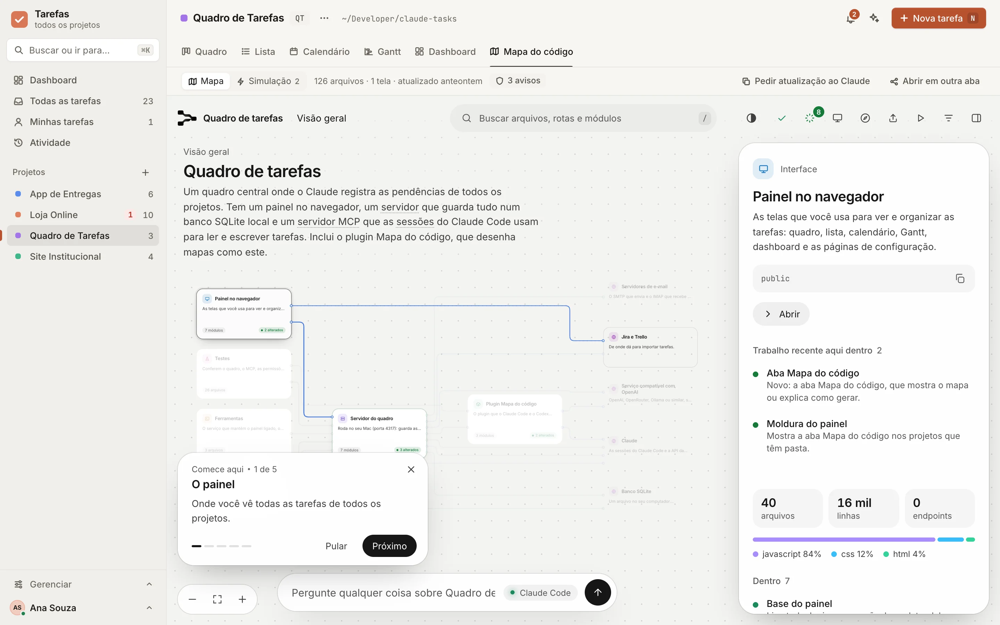
</picture>

<p align="center"><sub>O mapa deste próprio repositório, dentro da aba Mapa do código.</sub></p>

O **Mapa do código** é um plugin para Claude Code e Codex (em [`mapa/`](mapa)) que lê o código de um
projeto e desenha um mapa interativo dele. Cada parte, arquivo, endpoint e tela ganha um nome e uma
descrição em português simples, e as ligações entre eles aparecem no mapa, em vários níveis de zoom.

- **Saúde:** chaves e senhas escritas no código, endpoints abertos a qualquer pessoa e outros riscos,
  cada um com um botão para virar tarefa.
- **Fluxos guiados e tour** para quem chega ao projeto agora.
- **Trabalho recente:** o que acabou de mudar fica em destaque, explicado em relação ao que foi pedido.
- **Perguntas no próprio mapa**, respondidas pelo Claude Code ou pelo Codex.
- **Plantas:** antes de existir código, o mesmo mapa planejado a partir de um PRD.
- **No quadro:** cada projeto com pasta ganha a aba, e as tarefas que citam um arquivo aparecem presas
  ao cartão dele.

Instale uma vez e peça, na pasta do projeto, "faça o mapa do código deste projeto" (veja
[Instalação](#mapa-do-código-1)). O guia completo está em [docs/MAPA.md](docs/MAPA.md). O plugin é uma
tradução e adaptação do [Floorplan](https://github.com/haydenschmitty/floorplan), de Hayden Smith (MIT).

## Simulação: onde o sistema quebra

<picture>
  <source media="(prefers-color-scheme: dark)" srcset="docs/imagens/simulacao-escuro.webp" />
  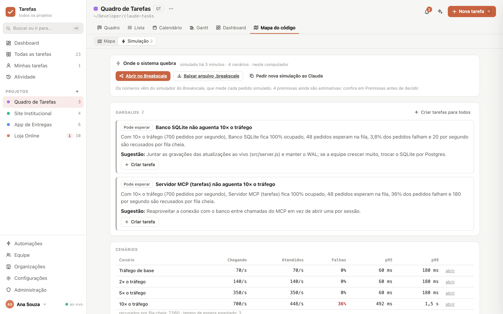
</picture>

O mapa mostra **como** o sistema se liga. A Simulação mostra **onde ele quebra**. Ela usa o
[Breakscale](https://github.com/workersio/breakscale), um simulador de arquitetura aberto (MIT): cada
servidor, banco e fila tem um número limitado de vagas e uma fila, e o simulador mede o que acontece com
cada pedido quando o tráfego sobe.

Peça ao Claude "simule este projeto no Breakscale". Ele:

1. monta o modelo do sistema a partir do mapa: telas viram origens de tráfego, e servidores,
   processadores de fila, bancos, caches e filas viram componentes;
2. troca os números padrão pelos do código (tamanho do pool, réplicas, timeouts) e marca o que veio do
   código e o que é estimativa;
3. simula com 1×, 2×, 5× e 10× o tráfego de base;
4. escreve uma sugestão para cada gargalo.

Na aba **Simulação** ficam os gargalos (cada um com **Criar tarefa**), a tabela de cenários, a ocupação
de cada componente, as premissas e o que ficou fora do modelo, além dos botões para abrir o modelo em
breakscale.tech ou baixar o arquivo `.breakscale`.

O simulador roda no seu computador, pelo pacote `breakscale-mcp` numa versão fixa, e o Claude Code pede
aprovação a cada simulação. Só se você pedir, ele usa o servidor do Breakscale, que recebe os nomes e as
ligações das peças, nunca o código. Detalhes em [docs/MAPA.md § 7.7](docs/MAPA.md#77-simulação-no-breakscale).

## O servidor MCP

O servidor MCP `tarefas` (versão 4.4, transporte stdio) tem **36 ferramentas**, **10 prompts** e
resources de leitura. Ele aceita os protocolos 2024-11-05, 2025-03-26, 2025-06-18 e 2025-11-25.

| Grupo | Ferramentas |
| --- | --- |
| Tarefas | `add_tasks`, `list_tasks`, `get_task`, `update_task`, `update_tasks`, `complete_tasks`, `delete_tasks`, `search`, `share_link` |
| Conversa e anexos | `add_comment`, `manage_comment`, `attach_file`, `get_attachment` |
| Projetos e fluxo | `list_projects`, `manage_project`, `manage_columns`, `manage_sprints`, `manage_labels`, `manage_fields` |
| Equipe | `list_members`, `manage_members`, `manage_workspaces` |
| Tempo | `timer`, `log_time`, `time_report` |
| Visão geral | `get_overview`, `get_activity`, `list_notifications`, `send_notification`, `show_in_dashboard` |
| Automação e e-mail | `manage_automations`, `manage_inbox`, `manage_settings` |
| Dados | `import_tasks`, `export_tasks` |
| Código | `code_map` (consulta o mapa e a última simulação) |

**Prompts:** `pendencias`, `proxima`, `registrar_pendencias`, `concluir`, `quebrar_tarefa`,
`planejar_sprint`, `triagem`, `relatorio` e `revisar_prazos`.

**Resources:** `tarefas://overview`, `tarefas://my-tasks`, `tarefas://tasks/{id}`,
`tarefas://projects/{id}` e `tarefas://projects/{id}/overview`.

Com `CLAUDE_TASKS_USER` e `CLAUDE_TASKS_ENFORCE=1`, o MCP age como uma pessoa da equipe e respeita as
permissões dela. A referência completa, com cada parâmetro e exemplo, está em [docs/MCP.md](docs/MCP.md).

## Como funciona

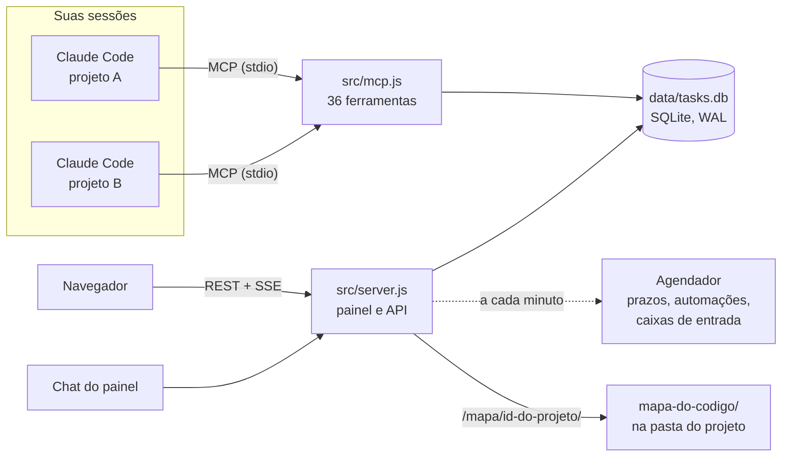

- **Um banco, vários processos.** O painel e cada sessão do MCP gravam no mesmo SQLite (modo WAL). O
  painel percebe gravações de qualquer processo em menos de um segundo e avisa os navegadores por SSE.
- **Regras iguais para todos.** Automações e notificações rodam em qualquer processo que grava, então
  valem também para o que o Claude faz.
- **Migrações seguras.** O esquema tem versão (`PRAGMA user_version`), e antes de cada migração o banco
  ganha um backup automático.
- **Sem dependências.** Servidor HTTP, MCP, SMTP, IMAP, cifra e testes usam só módulos do Node. O SDK da
  Anthropic é opcional, para o chat com chave de API.

## Instalação

### Requisitos

- **Node.js 22.13 ou mais novo.**
- **Claude Code** (a CLI `claude`), para o MCP e para o chat do painel no provedor padrão.
- **macOS** para o serviço que mantém o painel ligado (launchd), para as notificações do sistema e para
  o app. Em outros sistemas, rode com `npm start` ou com Docker.
- **Ferramentas de linha de comando do Xcode** (`xcode-select --install`), só para montar o app do Mac.
- **Opcional:** servidor SMTP, caixa IMAP e chave de API da Anthropic ou de um provedor compatível com a
  OpenAI.

### No Mac

```bash
# 1. Baixe o projeto
git clone https://github.com/editzffaleta/claude-tasks.git ~/Developer/claude-tasks

# 2. Deixe o MCP disponível em todos os projetos
claude mcp add --scope user tarefas -- "$(command -v node)" --no-warnings ~/Developer/claude-tasks/src/mcp.js

# (Opcional) O mesmo para o Codex
codex mcp add tarefas -- "$(command -v node)" --no-warnings ~/Developer/claude-tasks/src/mcp.js

# 3. Deixe o painel sempre ligado (inicia no login)
~/Developer/claude-tasks/bin/service.sh install
```

Depois:

1. Abra http://localhost:4317 e crie a conta de administrador.
2. (Recomendado) Acrescente ao seu `~/.claude/CLAUDE.md` uma instrução como esta. O servidor MCP já manda
   instruções parecidas ao conectar, mas isso deixa o hábito explícito em toda sessão:

   ```markdown
   # Quadro de tarefas

   Registre no quadro (MCP `tarefas`, `add_tasks` com `project_path` = a pasta atual) tudo o que ficar
   pendente: follow-ups que você sugerir, bugs que encontrar e não corrigir, etapas para depois. Não
   pergunte antes; avise numa linha. Antes de criar, confira `list_tasks` para não duplicar. Ao começar
   uma tarefa do quadro, mude para `doing`; ao terminar, use `complete_tasks` com uma nota curta.
   ```

   No Codex, a mesma instrução vai em `~/.codex/AGENTS.md`.

3. (Opcional) Chat do painel: rode `claude` no Terminal e faça `/login`, ou configure a API da Anthropic
   (`npm install` traz o SDK) ou uma API compatível com a OpenAI em **Configurações → IA do chat**.
4. (Opcional) E-mail em **Configurações → E-mail**.

Para atualizar: `git pull` e `launchctl kickstart -k gui/$(id -u)/com.claude-tasks.dashboard`. Para
remover o serviço: `bin/service.sh uninstall`.

### App para Mac


Um app nativo, o **Quadro de Tarefas.app**, abre o painel numa janela própria, com ícone no Dock, no
Launchpad e no Spotlight. Para montar e instalar em `~/Applications`:

```bash
~/Developer/claude-tasks/app/macos/build.sh --install
```

- **Liga o quadro sozinho.** Se o painel não responde, o app liga o serviço do launchd e, se ele nem
  estiver instalado, roda o `bin/service.sh install`. Enquanto isso, mostra "Ligando o quadro…".
- **Parece um app do Mac:** tema claro ou escuro do sistema, menus em português, copiar e colar,
  `⌘R` recarrega, `⌘+` e `⌘-` mudam o tamanho do texto, tela cheia e a janela volta no mesmo lugar.
- **Links e downloads:** links para fora (GitHub, Breakscale) abrem no navegador padrão, e
  downloads (CSV, `.breakscale`, anexos) vão para a pasta Downloads. Links do próprio quadro que abrem
  em outra aba, como o mapa, viram uma nova janela do app.
- **Login guardado:** você entra uma vez e o app lembra. Os cookies do app são separados dos do navegador.
- Se o painel não ligar, a janela mostra o motivo, **Tentar de novo** e **Abrir o log do servidor**.

O app é Swift puro (AppKit e WebKit), em [`app/macos/`](app/macos), sem dependências. O `build.sh`
guarda no app o endereço do painel, a pasta do repositório e o caminho do Node (um app aberto pelo Dock
não tem o PATH do Terminal). Se mudar o claude-tasks de pasta ou trocar o Node, monte de novo. Para outro
endereço: `CLAUDE_TASKS_URL=http://localhost:4400 app/macos/build.sh --install`.

### Docker

```bash
docker compose up -d        # http://localhost:4317, dados no volume "tarefas-data"
```

- Ajuste `CLAUDE_TASKS_HOSTS` no `docker-compose.yml` com o `host:porta` usado no navegador (ou `*` atrás
  de um proxy que valida o domínio).
- Não há CLI do Claude Code no contêiner: no chat, use a API da Anthropic ou uma compatível com a OpenAI.
- O MCP roda onde o Claude Code roda e precisa do mesmo banco. Use
  `docker exec -i <contêiner> node --no-warnings src/mcp.js` como comando do MCP (melhor no Mac) ou monte
  uma pasta do host como `/data` e aponte `CLAUDE_TASKS_DB` para ela (seguro no Linux). Detalhes em
  [docs/SISTEMA.md § 3.4](docs/SISTEMA.md#34-docker).

### Mapa do código

Instale o plugin uma vez:

```bash
claude plugin marketplace add ~/Developer/claude-tasks
claude plugin install mapa-do-codigo@claude-tasks
```

Depois, numa sessão nova do Claude Code na pasta de um projeto, peça "faça o mapa do código deste
projeto" e, mais tarde, "atualize o mapa do código". Com o mapa pronto, "simule este projeto no
Breakscale" mostra onde o sistema quebra. No Codex, rode
`codex plugin marketplace add ~/Developer/claude-tasks` e instale "Mapa do código" em Plugins.

### Pendências no início de cada sessão

Para o Claude já começar cada sessão sabendo o que está aberto no projeto, acrescente este hook ao
`~/.claude/settings.json` (troque os caminhos pelos da sua máquina):

```json
{
  "hooks": {
    "SessionStart": [
      {
        "matcher": "startup|clear|compact",
        "hooks": [
          {
            "type": "command",
            "command": "/Users/voce/.local/bin/node --no-warnings /Users/voce/Developer/claude-tasks/bin/session-start.js",
            "timeout": 10
          }
        ]
      }
    ]
  }
}
```

## Usar em equipe

Por padrão o painel só aceita conexões do próprio computador. Para outras pessoas acessarem pela rede,
rode o servidor ouvindo em todas as interfaces e liste os endereços permitidos:

```bash
CLAUDE_TASKS_HOST=0.0.0.0 CLAUDE_TASKS_HOSTS=meumac.local:4317,192.168.0.10:4317 npm start
```

Depois preencha **Configurações → Endereço público do painel**, organize os projetos em **Organizações**
e convide as pessoas em **Equipe → Convidar pessoa**. O link do convite é copiado e, com SMTP, pode ir por
e-mail. Para acesso pela internet, coloque o painel atrás de um proxy com HTTPS, como o Tailscale ou o
Cloudflare Tunnel.

## Atalhos do teclado

| Atalho | O que faz |
| --- | --- |
| `⌘K` | Busca universal e comandos |
| `N` | Nova tarefa |
| `/` | Filtrar a visão atual |
| `C` | Abrir o chat |
| `1` a `5` | Trocar de visão (Quadro, Lista, Calendário, Gantt, Dashboard) |
| Setas | No quadro, andar entre os cartões |
| `Shift` + setas | No quadro, levar o cartão para outra coluna ou posição |
| `Enter` | Abrir o cartão focado |
| `Esc` | Fechar o painel ou o diálogo aberto |

Os atalhos de uma tecla podem ser desligados em **Minha conta → Preferências**. Os menus também funcionam pelo teclado
(setas, `Home`, `End` e a inicial do item), e a triagem guiada tem atalhos próprios.

## Dados, backup e privacidade

- **Tudo fica na pasta `data/`:** o banco `tasks.db`, `attachments/`, `avatars/` e `secret.key`, a chave
  que cifra senhas de SMTP, IMAP e chaves de API. Guarde a chave junto com o banco.
- **Backups:** antes de cada migração de esquema sai um backup automático
  (`data/backup-v<versão>-<data>.db`). Backups manuais, download e manutenção ficam em **Administração**.
- **Nada sai do seu computador por conta própria.** Não há telemetria nem analytics. O que vai para fora
  é o que você liga: o chat (para o provedor escolhido), o e-mail, as importações do Jira e do Trello e,
  só se você pedir, a simulação no servidor do Breakscale.
- **Segurança:** sessões em cookie `HttpOnly`, conferência de `Host` e `Origin`, senhas com scrypt e
  permissões conferidas no servidor em cada rota e em cada ferramenta do MCP. Veja
  [docs/SISTEMA.md](docs/SISTEMA.md).

## Desenvolvimento

```bash
npm start            # painel em http://localhost:4317
npm test             # 259 testes: API, MCP, permissões, e-mail, mapa e o plugin do mapa
npm run i18n:check   # confere os dicionários dos idiomas do painel
npm run mcp          # servidor MCP no terminal
```

A CI ([`.github/workflows/ci.yml`](.github/workflows/ci.yml)) roda os testes no Node 22 e 24, confere os
dicionários e a sintaxe do painel e constrói e testa a imagem Docker.

Para testar o painel sem tocar no seu quadro, `node scripts/demo.mjs` sobe um quadro de demonstração (projetos,
pessoas e tarefas fictícios, com oito semanas de história) numa pasta temporária, na porta 4395. As imagens deste
README saem dele com `node scripts/fotos.mjs --base http://localhost:4395 --senha <arquivo que o demo mostra> --banner`,
que fotografa cada tela nos temas claro e escuro com o Chrome sem janela; `--revisao` inclui as telas que não vão
para o README (login, paleta, nova tarefa, configurações, celular).

### Variáveis de ambiente

| Variável | Para que serve |
| --- | --- |
| `CLAUDE_TASKS_DB` | Caminho do banco (padrão `data/tasks.db`) |
| `CLAUDE_TASKS_PORT` | Porta do painel (padrão `4317`) |
| `CLAUDE_TASKS_HOST` | Endereço em que o painel ouve (padrão `127.0.0.1`) |
| `CLAUDE_TASKS_HOSTS` | Hosts extras permitidos, separados por vírgula, ou `*` |
| `CLAUDE_TASKS_USER` · `CLAUDE_TASKS_ENFORCE` | Quem é "eu" no MCP e se as permissões valem para ele |
| `CLAUDE_TASKS_JIRA_HOSTS` | Hosts do Jira permitidos na importação |
| `CLAUDE_BIN` | CLI do Claude usada pelo chat |
| `CLAUDE_TASKS_NO_OS_NOTIFY=1` | Desliga as notificações do macOS |

A lista completa está em [docs/SISTEMA.md § 3.6](docs/SISTEMA.md#36-variáveis-de-ambiente).

### Estrutura do projeto

```
claude-tasks/
├── src/
│   ├── server.js        servidor HTTP: painel, API REST, SSE, /mapa/<projeto>/
│   ├── routes.js        as rotas da API, com as permissões de cada uma
│   ├── db.js            esquema, migrações e regras do quadro (SQLite)
│   ├── store/           equipe, organizações, trabalho, metadados e indicadores
│   ├── mcp.js           servidor MCP (stdio)
│   ├── mcp/             ferramentas, resources e prompts do MCP
│   ├── engine.js        automações e notificações
│   ├── mapa.js          o Mapa do código e a Simulação dentro do quadro
│   ├── chat.js          chat do painel (CLI, Anthropic ou compatível com OpenAI)
│   ├── mailer.js · mail/  e-mail (SMTP)
│   ├── inbox.js         caixas de entrada por e-mail (IMAP)
│   ├── importers.js     CSV, Jira e Trello
│   └── openapi.js       documento OpenAPI 3.1
├── public/              o painel: HTML, CSS e módulos JS sem build
│   ├── styles.css       os tokens da linguagem visual (cores, tipos, movimento) e os componentes
│   ├── fonts/           Inter e JetBrains Mono, servidas pelo próprio painel
│   └── js/i18n/         dicionários en, es, fr e de (as chaves são o texto em português)
├── mapa/                o plugin Mapa do código (Claude Code e Codex)
├── app/macos/           o app para Mac (Swift: AppKit e WebKit) e o build.sh que monta o .app
├── bin/                 serviço do launchd e hook de início de sessão
├── scripts/             conferência das traduções, quadro de demonstração e fotos do README
├── test/                testes do quadro (node:test)
├── docs/                SISTEMA.md, MCP.md, MAPA.md e as imagens deste README
├── Dockerfile · docker-compose.yml
└── .claude-plugin/ · .agents/plugins/   este repositório como marketplace de plugins
```

## Documentação

- **[docs/SISTEMA.md](docs/SISTEMA.md):** arquitetura, instalação, conceitos e regras, papéis e
  permissões, cada tela, automações, notificações, e-mail, importação, chat, modelo de dados, migrações,
  segurança e solução de problemas.
- **[docs/MCP.md](docs/MCP.md):** cada ferramenta, prompt e resource do servidor MCP, com parâmetros e
  exemplos.
- **[docs/MAPA.md](docs/MAPA.md):** o Mapa do código e a Simulação: instalação, primeiro mapa, plantas,
  cada botão, integração com o quadro e privacidade.
- **API REST:** o documento OpenAPI 3.1 fica em `/api/openapi.json` e a referência navegável em
  http://localhost:4317/docs/api.

## Contribuindo

Contribuições são bem-vindas: correções, traduções, documentação e funcionalidades.

1. Faça um fork e crie uma branch a partir da `main`.
2. Rode `npm test` e `npm run i18n:check` antes de abrir o PR.
3. Abra o PR explicando o que muda e por quê.

Algumas regras da casa:

- **Sem dependências obrigatórias.** Use os módulos do Node.
- **Textos do painel em português, passando por `t()`**, com a tradução nos quatro dicionários de
  `public/js/i18n/`. O `i18n:check` aponta o que faltar.
- **Permissões no servidor.** Toda rota e toda ferramenta do MCP confere o papel de quem pede.
- **Teste junto com a mudança** e documentação atualizada em `docs/`.

Achou um problema ou tem uma ideia? Abra uma [issue](https://github.com/editzffaleta/claude-tasks/issues).

## Licença e créditos

[MIT](LICENSE).

- **[Taskosaur](https://github.com/Taskosaur/Taskosaur)** foi a inspiração para o conjunto de
  funcionalidades de gestão de projetos. O código daqui foi escrito do zero.
- **[Floorplan](https://github.com/haydenschmitty/floorplan)** 0.6.0, de Hayden Smith (MIT), é a base do
  plugin Mapa do código. A licença original e o aviso sobre a adaptação estão em
  [`mapa/LICENSE`](mapa/LICENSE) e [`mapa/AVISO.md`](mapa/AVISO.md).
- **[Breakscale](https://github.com/workersio/breakscale)**, de xevrion (MIT), é o simulador usado na
  Simulação. Nenhum código dele vem neste repositório: o pacote `breakscale-mcp` é baixado na hora de
  simular.
- **[elkjs](https://github.com/kieler/elkjs)** (EPL-2.0) organiza o desenho do mapa, e as fontes
  **Inter** e **JetBrains Mono** (OFL-1.1) vêm embutidas nele.
